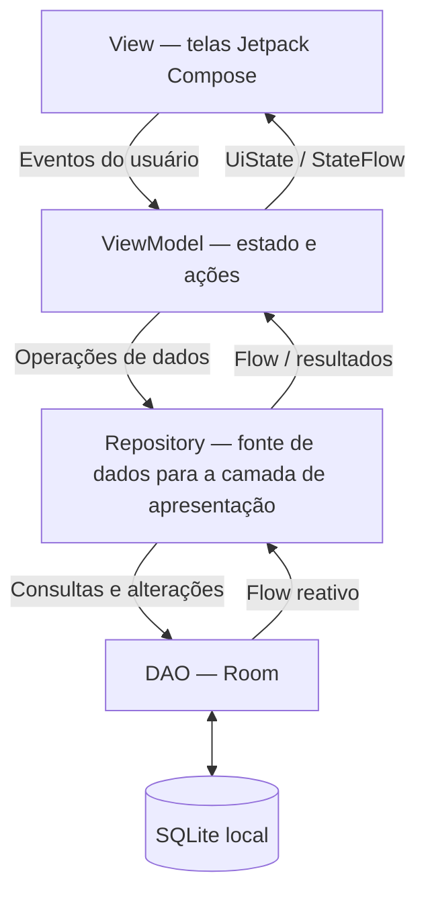

# HabitFlow3 — Trabalho 4: Arquitetura MVVM

**Disciplina:** Desenvolvimento de Aplicativos Móveis  
**Atividade:** Trabalho 4 — Arquitetura MVVM (continuação do Trabalho 3)  
**Aplicativo:** HabitFlow3 — gerenciamento de hábitos e metas  


## 1. Histórico do projeto

O HabitFlow3 foi desenvolvido em etapas na disciplina de Desenvolvimento de Aplicativos Móveis:

| Trabalho | Evolução do aplicativo |
| --- | --- |
| **Trabalho 1** | Planejamento do produto, desenho de telas e primeiras interfaces com Jetpack Compose. |
| **Trabalho 2** | Navegação real entre telas, listas, formulários e interação com os dados em memória. |
| **Trabalho 3** | Persistência dos hábitos e metas com Room, incluindo operações de cadastro, consulta, atualização e exclusão (CRUD). |
| **Trabalho 4** | **Refatoração para MVVM:** introdução de Repositories, DAOs reativos com `Flow`, ViewModels separados, estados `UiState`/`StateFlow` e injeção por `ViewModelFactory`. |

### Como estava no Trabalho 3?

O código utilizava as entidades `HabitoEntity` e `MetaEntity`, seus DAOs e um ViewModel centralizado (`HabitFlowViewModel`). Esse ViewModel se comunicava diretamente com a camada Room, mantinha listas em estados Compose e precisava consultar novamente os registros em parte das operações.

### O que mudou no Trabalho 4?

A refatoração substituiu esse ViewModel centralizado por `HabitosViewModel` e `MetasViewModel`, criou **um Repository por entidade** e tornou reativas as consultas de listagem dos DAOs. Os campos dos formulários e os dados necessários para a apresentação são agrupados nos respectivos `UiState`. A navegação e as funcionalidades de hábitos e metas continuam disponíveis.

**Escopo preservado:** o Trabalho 4 não introduz novas telas, campos de banco ou funcionalidades de negócio.

## 2. Funcionalidades preservadas

O projeto mantém os seguintes recursos implementados na evolução do HabitFlow3:

- **Hábitos:** cadastrar, listar, visualizar detalhes, editar e excluir; registrar dias realizados; concluir e reabrir hábitos; consultar histórico de hábitos concluídos.
- **Metas:** cadastrar, listar, visualizar detalhes, editar e excluir; marcar como concluída e retornar ao estado pendente.
- **Resumos:** consultar os indicadores de hábitos e metas na tela inicial e no perfil.
- **Navegação:** manter as **nove rotas** previstas na versão refatorada (início, hábitos, cadastro de hábito, detalhe de hábito, edição de hábito, metas, detalhe de meta, histórico e perfil).
- **Persistência:** manter os registros no banco local Room, inclusive após fechar e reabrir o aplicativo.

## 3. Arquitetura MVVM

A arquitetura organiza o projeto em responsabilidades distintas:



| Camada | Responsabilidade | Exemplos no projeto |
| --- | --- | --- |
| **View** | Desenhar as telas, observar estados e encaminhar interações. | `TelaDashboard.kt`, `TelaMetas.kt`, `AppNavigation.kt` |
| **ViewModel** | Manter estado da interface, validar dados e executar ações através dos Repositories. | `HabitosViewModel.kt`, `MetasViewModel.kt` |
| **UiState** | Agrupar informações necessárias à renderização, inclusive formulários e estados de carregamento/erro. | `HabitosUiState.kt`, `MetasUiState.kt` |
| **Repository** | Ser o ponto de acesso aos dados para os ViewModels, ocultando a implementação Room. | `HabitoRepository.kt`, `MetaRepository.kt` |
| **Model / persistência** | Representar e consultar os registros armazenados localmente. | `HabitoEntity`, `MetaEntity`, DAOs e `AppDatabase` |

A **View não acessa o DAO diretamente**; o ViewModel acessa o Repository, e somente o Repository acessa o DAO. Dessa forma, alterações na estratégia de armazenamento ficam concentradas na camada de dados.

## 4. Organização dos pacotes

```text
app/src/main/java/com/example/habitflow3/
├── MainActivity.kt
├── data/
│   ├── Datas.kt
│   ├── local/
│   │   ├── AppDatabase.kt
│   │   ├── HabitoDao.kt
│   │   ├── HabitoEntity.kt
│   │   ├── MetaDao.kt
│   │   └── MetaEntity.kt
│   └── repository/
│       ├── HabitoRepository.kt
│       └── MetaRepository.kt
├── ui/
│   ├── AppNavigation.kt
│   ├── screens/
│   │   ├── Componentes.kt
│   │   ├── TelaCadastroHabito.kt
│   │   ├── TelaDashboard.kt
│   │   ├── TelaDetalheHabito.kt
│   │   ├── TelaDetalheMeta.kt
│   │   ├── TelaHistorico.kt
│   │   ├── TelaInicial.kt
│   │   ├── TelaMetas.kt
│   │   └── TelaPerfil.kt
│   └── theme/
│       └── HabitFlowTheme.kt
└── viewmodel/
    ├── HabitosUiState.kt
    ├── HabitosViewModel.kt
    ├── MetasUiState.kt
    ├── MetasViewModel.kt
    └── ViewModelFactory.kt
```

**Por que esses pacotes foram criados?**

- `ui`: reúne componentes visuais, telas, navegação e tema, isolando a apresentação das operações de banco.
- `data.local`: mantém as entidades, consultas e configuração do banco Room.
- `data.repository`: concentra o acesso às fontes de dados e impede dependência direta do DAO nos ViewModels.
- `viewmodel`: contém as ações, o estado de apresentação, os formulários e a fábrica de criação dos ViewModels.

Os pacotes contêm arquivos Kotlin reais; não foram criadas apenas pastas vazias para atender ao enunciado.

## 5. Principais decisões técnicas

### 5.1 Repository por entidade

Foram criados dois Repositories:

- `HabitoRepository`: operações sobre hábitos, incluindo cadastro, atualização, exclusão, registro de dias, conclusão e reabertura.
- `MetaRepository`: operações sobre metas, incluindo cadastro, atualização, exclusão e alteração do status de conclusão.

Cada Repository recebe o DAO correspondente por construtor e apresenta métodos próprios à camada superior. Assim, os ViewModels não ficam acoplados à implementação Room.

### 5.2 DAO reativo com `Flow`

Os métodos de listagem de ambos os DAOs retornam `Flow`:

```kotlin
// HabitoDao.kt
@Query("SELECT * FROM habitos ORDER BY id DESC")
fun buscarTodos(): Flow<List<HabitoEntity>>

// MetaDao.kt
@Query("SELECT * FROM metas ORDER BY id DESC")
fun buscarTodos(): Flow<List<MetaEntity>>
```

O Room emite novos resultados quando os registros observados são alterados. Os ViewModels coletam essas emissões e atualizam seus estados, dispensando um recarregamento manual das listas após cada operação.

### 5.3 ViewModels e UiState

O ViewModel centralizado foi substituído por dois componentes:

| ViewModel | Estado exposto | Conteúdo principal |
| --- | --- | --- |
| `HabitosViewModel` | `StateFlow<HabitosUiState>` | Lista de hábitos, hábito selecionado, formulário de cadastro/edição, estados de carregamento/salvamento e erros. |
| `MetasViewModel` | `StateFlow<MetasUiState>` | Lista de metas, meta selecionada, formulários separados de cadastro e edição, estados de carregamento/salvamento e erros. |

Cada ViewModel mantém `_uiState` como `MutableStateFlow` **privado** e disponibiliza `uiState` como `StateFlow` de **leitura pública**. As telas observam esse estado com `collectAsStateWithLifecycle()`.

Os campos dos formulários são mantidos nos respectivos `UiState`. Os Composables enviam alterações ao ViewModel por métodos específicos, como `atualizarNome(...)`, em vez de concentrar esses dados em diversas variáveis `remember`. Estados apenas visuais, como a abertura de um diálogo, podem continuar locais à tela.

Também foram incluídos valores derivados de apresentação, como listas de hábitos ativos/concluídos e totais de metas, para reduzir os cálculos repetidos nos Composables.

### 5.4 ViewModelFactory e injeção das dependências

`ViewModelFactory` implementa a criação dos ViewModels que recebem seus Repositories por construtor. Em `MainActivity.kt`, o banco é obtido por `AppDatabase.obter(...)`, os Repositories são criados com os DAOs e entregues à fábrica. A interface recebe os ViewModels já configurados.

Essa abordagem evita criar instâncias do banco diretamente dentro de telas ou ViewModels.

### 5.5 Preservação do banco do Trabalho 3

A refatoração preserva:

- As tabelas **`habitos`** e **`metas`** e seus respectivos campos.
- O nome do banco **`habitflow3_database`**.
- A versão do Room Database (**1**).
- O `applicationId` **`com.example.habitflow3`**.

O código não utiliza `fallbackToDestructiveMigration()`. Mover arquivos Kotlin para outros pacotes não modifica, por si só, o esquema físico do SQLite.

## 6. Tecnologias e versões

Configuração conferida nos arquivos Gradle da versão corrigida:

| Tecnologia | Versão / configuração |
| --- | --- |
| Android Studio | **2025.3.1 Panda**, ambiente utilizado para desenvolver e abrir o projeto |
| Linguagem | Kotlin **2.0.21** |
| Interface | Jetpack Compose, Material 3 |
| Navegação | Navigation Compose **2.8.5** |
| Persistência | Room **2.6.1** + KSP |
| Gerenciamento de estado | ViewModel, `StateFlow`, `UiState` e Lifecycle **2.8.7** |
| Android Gradle Plugin | **8.9.2** |
| Gradle Wrapper | **8.11.1** |
| Java / JDK | **17** |
| `compileSdk` / `targetSdk` | **35** / **35** |
| `minSdk` | **26** |

## 7. Como executar o projeto

### Pré-requisitos

- Android Studio 2025.3.1 Panda.
- JDK 17 configurado para o Gradle.
- Android SDK 35 instalado e emulador ou dispositivo com Android API 26 ou superior.
- Conexão com a internet na primeira sincronização das dependências.

### Passo a passo no Windows

1. Baixe o projeto e extraia os arquivos, se estiver usando ZIP.
2. Caso a pasta `gradle/wrapper` ainda não tenha `gradle-wrapper.jar`, execute **`PREPARAR_WINDOWS.bat`** na raiz do projeto. Esse script obtém o arquivo oficial e verifica seu hash SHA-256. Se o JAR já existir e for válido, não é necessário baixá-lo novamente.
3. Abra o Android Studio e selecione **File > Open**.
4. Selecione a pasta **`HabitFlow3`**, que contém `settings.gradle.kts`, `build.gradle.kts` e `app/` — **não** apenas a pasta `app`.
5. Aguarde a sincronização do Gradle e confira o uso do **JDK 17**.
6. Execute **Build > Make Project** e, em seguida, rode a configuração `app` em um emulador ou dispositivo.

Caso o Android Studio não reconheça o módulo `app`, feche o projeto e abra novamente a **pasta raiz**, verificando que `settings.gradle.kts` contém `include(":app")`.

### Comandos úteis (PowerShell, na raiz do projeto)

```powershell
# Compilar o APK de depuração
.\gradlew.bat :app:assembleDebug

# Executar testes unitários
.\gradlew.bat :app:testDebugUnitTest

# Executar testes instrumentados (com emulador ou aparelho conectado)
.\gradlew.bat :app:connectedDebugAndroidTest
```

## 8. Testes e persistência

### 8.1 Testes incluídos no código

| Arquivo | Objetivo |
| --- | --- |
| `app/src/test/java/com/example/habitflow3/DatasTest.kt` | Validar funções de conversão e tratamento de datas. |
| `app/src/androidTest/java/com/example/habitflow3/PersistenciaRoomTest.kt` | Verificar operações CRUD de hábitos e metas com Room. |
| `app/src/androidTest/java/com/example/habitflow3/PersistenciaAposReabrirTest.kt` | Gravar registros, fechar o banco e abri-lo novamente para consultar os mesmos dados. |
| `app/src/androidTest/java/com/example/habitflow3/FlowReativoRoomTest.kt` | Observar atualizações de hábitos e metas durante uma mesma coleta de `Flow`. |

**Situação dos testes:** os arquivos de teste estão implementados. Os resultados dos comandos Gradle acima ainda devem ser registrados após execução no computador da equipe. O fato de o aplicativo abrir no Android Studio, por si só, não comprova a aprovação de todos os testes instrumentados.

### 8.2 Roteiro de validação manual

- [ ] Cadastrar um hábito e uma meta.
- [ ] Navegar para os respectivos detalhes.
- [ ] Editar os registros e conferir as listas atualizadas.
- [ ] Registrar um dia realizado em um hábito.
- [ ] Concluir e reabrir um hábito; verificar o histórico.
- [ ] Marcar uma meta como concluída e retorná-la a pendente.
- [ ] Excluir um hábito e uma meta de teste.
- [ ] Fechar completamente o aplicativo e abri-lo novamente.
- [ ] Comprovar que os registros não excluídos continuam armazenados.
- [ ] Executar os testes automatizados e registrar os resultados.

**Registro dos resultados de testes (preencher depois de executar):**

| Verificação | Resultado | Evidência |
| --- | --- | --- |
| Compilação `assembleDebug` | A confirmar | Inserir print/log |
| Testes unitários | A confirmar | Inserir print/log |
| Testes instrumentados | A confirmar | Inserir print/log |
| Persistência após reabrir o aplicativo | A confirmar | Inserir vídeo/prints |

## 9. Desafios da refatoração e soluções

As situações técnicas identificadas durante a evolução do código foram:

| Situação | Causa | Decisão adotada |
| --- | --- | --- |
| Incompatibilidade entre `Flow<List<...>>` e `List<...>` | O ViewModel antigo esperava listas diretamente, enquanto os DAOs passaram a devolver fluxos reativos. | Substituir o ViewModel centralizado pelos novos ViewModels que coletam `Flow` e atualizam `StateFlow`. |
| Atualização manual das listas | Os dados eram consultados novamente após determinadas alterações. | Usar as emissões reativas do Room para atualizar o estado. |
| Mistura de responsabilidades | A apresentação dependia diretamente de componentes de persistência. | Criar Repositories por entidade e separar os pacotes. |
| Campos do formulário espalhados pela interface | Parte do estado permanecia em variáveis locais dos Composables. | Centralizar os formulários em `HabitosUiState` e `MetasUiState`. |
| Seleção do registro em telas de detalhes | A navegação precisa abrir o item correto sem carregar uma lista inteira na interface. | Consultar/observar o item pelo identificador através do ViewModel e do Repository. |
| Preservação dos dados existentes | Uma refatoração não deve recriar tabelas nem excluir registros. | Manter nomes das tabelas, colunas, versão do banco e identificador do aplicativo. |
